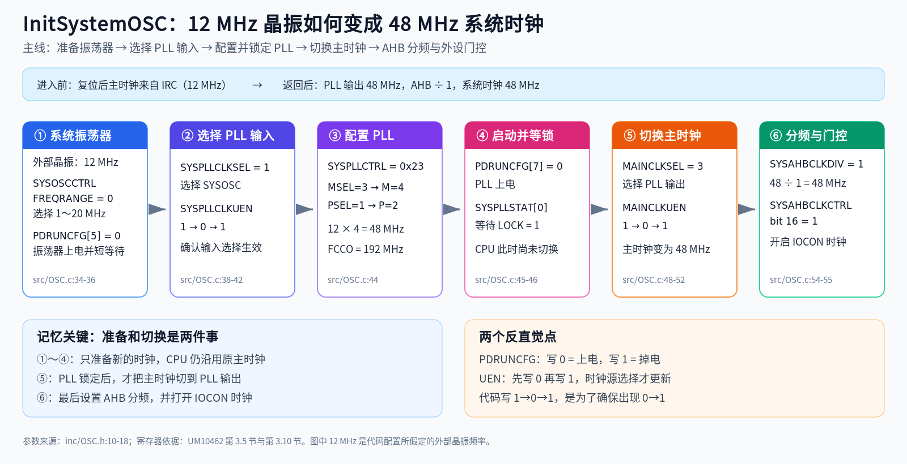
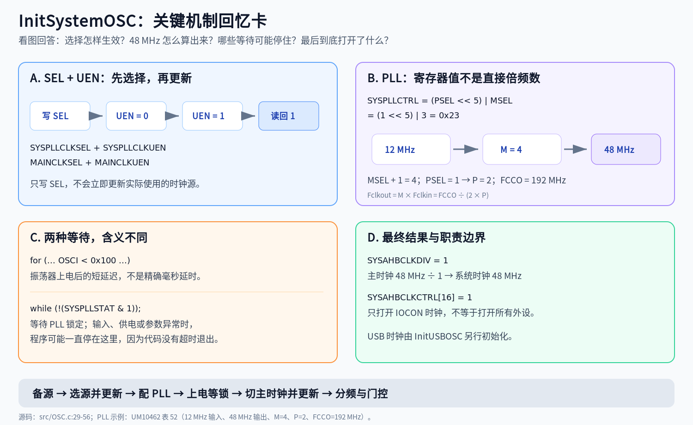

# InitSystemOSC：图像化代码学习与回忆方案

> 快速复习：只看第二、四、六节；第一次系统学习：按顺序阅读并对照源码。

## 一、推荐的总体方案

最适合这个项目的方案，不是把文字全部替换成图片，而是让四种材料各司其职：

1. **结构图负责快速回忆**：先看数据或时钟从哪里来到哪里去，恢复整体上下文。
2. **机制图负责理解难点**：把 `UEN` 更新、PLL 计算、等待条件等容易混淆的机制单独画出来。
3. **表格和手册负责精确定义**：寄存器地址、位号、取值及限制仍以手册为准，避免图片简化后产生误解。
4. **源码行号和回忆问题负责落地**：能从图跳回代码，也能在不看答案时检查自己是否真的记住。

主要取舍是：**图片更擅长表达关系，但会省略细节；文字和表格精确，却不利于快速恢复全貌。因此采用“图在前、表在后、源码可定位”的组合，而不是二选一。**

建议的使用节奏：

- 第一次学习：看结构图 → 对照源码逐行走一遍 → 查手册核对表格。
- 后续复习：只看两张图，尝试复述执行顺序；卡住时再点源码。
- 间隔复习：不看正文完成文末问题，把答错的位置标成自己的“易忘点”。

下面直接用 `InitSystemOSC` 做出第一版模板。

---

## 二、30 秒恢复全貌：这个函数在做什么

`InitSystemOSC` 位于 `src/OSC.c:29-56`，在 `Device_Init` 中由 `src/device.c:420` 调用。它的任务可以概括为：

> **把代码所假定的 12 MHz 外部晶振配置为系统 PLL 输入，得到 48 MHz PLL 输出，等 PLL 锁定后切换主时钟，再设置 AHB 分频并开启 IOCON 时钟。**



[查看可缩放的 SVG 版本](assets/InitSystemOSC_时钟路径.svg)

### 最值得记住的顺序

```text
备源 → 选源并更新 → 配 PLL → 上电等锁 → 切主时钟并更新 → 分频与门控
```

这里最关键的理解是：**“准备好 PLL 输出”和“让 CPU 使用 PLL 输出”是两个不同阶段。** 前四个阶段只做准备；直到 `MAINCLKSEL` 与 `MAINCLKUEN` 更新后，主时钟才真正切换。

> 图中的 12 MHz 来自 `inc/OSC.h:14` 的 `OSC` 宏，代表当前代码对硬件的配置假设。仅凭这段代码不能证明实际电路上的晶振频率，仍需结合原理图或实物核对。

---

## 三、从图跳回源码：每一步为什么存在

| 阶段 | 源码位置 | 实际操作 | 存在的意义 | 手册依据 |
|---|---|---|---|---|
| 配置振荡器频段 | `src/OSC.c:34` | `FREQRANGE = 0` | 让片内振荡电路选择 1～20 MHz 频段，与 12 MHz 晶振匹配 | 第 3.5.7 节、表 13 |
| 振荡器上电 | `src/OSC.c:35-36` | 清 `PDRUNCFG[5]`，短循环等待 | 给晶体振荡器上电，并留出简短等待 | 表 47 |
| 选择 PLL 输入 | `src/OSC.c:38-42` | `SYSPLLCLKSEL = 1`，随后操作 `SYSPLLCLKUEN` | 选择系统振荡器，并让新选择真正生效 | 第 3.5.11～3.5.12 节、表 17～18 |
| 配置 PLL 参数 | `src/OSC.c:44` | 写入 `SYSPLLCTRL` | 设置反馈分频 `M` 和后分频 `P`，决定 PLL 输出频率 | 表 9、第 3.10.4 节 |
| PLL 上电并等锁 | `src/OSC.c:45-46` | 清 `PDRUNCFG[7]`，等待 `SYSPLLSTAT[0] = 1` | 启动 PLL，确认输出稳定可用后再使用 | 表 47、表 10、第 3.10.1 节 |
| 切换主时钟 | `src/OSC.c:48-52` | `MAINCLKSEL = 3`，随后操作 `MAINCLKUEN` | 选择 PLL 输出作为主时钟，并使选择生效 | 第 3.5.15～3.5.16 节、表 21～22 |
| 分频与外设门控 | `src/OSC.c:54-55` | `SYSAHBCLKDIV = 1`，置 `SYSAHBCLKCTRL[16]` | AHB 不分频，得到 48 MHz 系统时钟；开启 IOCON 时钟 | 表 23～24 |

阅读这张表时，不建议孤立背寄存器名称，而应将每个寄存器归入一种职责：

- **电源开关**：`PDRUNCFG`；
- **时钟源选择**：`SYSPLLCLKSEL`、`MAINCLKSEL`；
- **让选择生效**：两个 `UEN`；
- **频率参数**：`SYSPLLCTRL`；
- **状态反馈**：`SYSPLLSTAT`；
- **输出分频和外设门控**：`SYSAHBCLKDIV`、`SYSAHBCLKCTRL`。

这样以后看到类似初始化代码，可以先识别“它属于哪一类操作”，再查具体位定义。

---

## 四、把最容易遗忘的机制单独画出来



[查看可缩放的 SVG 版本](assets/InitSystemOSC_关键机制回忆卡.svg)

### 1. 为什么写了 `SEL`，还要操作 `UEN`

`SYSPLLCLKSEL` 和 `MAINCLKSEL` 负责记录“希望选择哪个时钟源”，但手册要求通过对应 `UEN` 位产生从 `0` 到 `1` 的更新过程，实际时钟源才会切换。

代码采用：

```text
UEN = 1 → UEN = 0 → UEN = 1 → 等待读回 1
```

前两次写操作先把 `UEN` 确定为 `0`，第三次再写 `1`，从而确保无论原值是什么，都能形成一次明确的 `0 → 1`。因此，`SEL` 和 `UEN` 应作为一个整体记忆：**SEL 负责选，UEN 负责让选择生效。**

### 2. 12 MHz 为什么最终是 48 MHz

当前参数位于 `inc/OSC.h:14-18`：

```text
OSC  = 12 MHz
MSEL = 3 → M = MSEL + 1 = 4
PSEL = 1 → P = 2
SYSPLLCTRL = (PSEL << 5) | MSEL = 0x23
```

根据 UM10462 第 3.10.4 节：

```text
Fclkout = M × Fclkin = FCCO ÷ (2 × P)
Fclkout = 4 × 12 MHz = 48 MHz
FCCO    = 2 × 2 × 48 MHz = 192 MHz
```

`FCCO = 192 MHz` 落在手册规定的 156～320 MHz 内。手册表 52 给出的第一个示例正好也是：12 MHz 输入、`MSEL = 3`、`PSEL = 1`、48 MHz 输出、192 MHz FCCO。

最后 `SYSAHBCLKDIV = 1` 表示除以 1，所以系统时钟仍为 48 MHz。**`PSEL` 不是用来把最终的 48 MHz 再除以 4。**

### 3. 为什么清 `PDRUNCFG` 反而是上电

`PDRUNCFG` 中的 `SYSOSC_PD` 和 `SYSPLL_PD` 是“掉电控制”位：

```text
写 0 = Powered（上电）
写 1 = Powered down（掉电）
```

所以 `PDRUNCFG &= ~(1 << 5)` 和 `PDRUNCFG &= ~(1 << 7)` 分别是在给系统振荡器和系统 PLL 上电，而不是关闭它们。

### 4. 两个等待不能混为一谈

- `src/OSC.c:36` 的 `for` 循环只是振荡器上电后的短延迟，循环次数不是时间单位，不能直接当成固定的毫秒延时。
- `src/OSC.c:46` 的 `while` 是在等 PLL 的硬件锁定状态。只有锁定后才切换主时钟，避免使用尚未稳定的 PLL 输出。

第二个循环没有超时处理。如果晶振、PLL 输入选择、供电或参数存在异常，程序可能一直停在 `src/OSC.c:46`，这也是一个很重要的调试点。

---

## 五、这段代码值得附在图边的“易忘点”

这些内容不需要在第一次阅读时全部背下来，但很适合作为个人错题记录：

1. **`OSC` 宏不配置实际晶振。** 它只是软件计算使用的频率数值，实际硬件必须与它一致。
2. **`FREQRANGE` 不产生频率。** 它选择振荡器工作频段；倍频由 PLL 完成。
3. **最后一次写 `SYSAHBCLKCTRL` 只开启 IOCON。** 这不代表其他外设时钟都已开启。
4. **`SYSAHBCLKDIV = 0` 不是“不分频”。** 手册规定 `1` 才是除以 1，`0` 会关闭系统时钟。
5. **`SYSOSCCTRL |= ...` 只会置位，不会主动清位。** 当前上电时 `FREQRANGE` 复位值为 0，所以现有配置符合预期；但如果以后在运行中从高频段重新配置为低频段，需要特别注意这一写法。
6. **USB 时钟不在这个函数里完成。** `Device_Init` 后续还通过 `src/device.c:429` 调用 `InitUSBOSC`。

---

## 六、不看正文，尝试回答这 6 个问题

1. 为什么 `SYSPLLCLKSEL` 写完后还要操作 `SYSPLLCLKUEN`？
2. 为什么要先等待 `SYSPLLSTAT.LOCK`，再设置 `MAINCLKSEL = 3`？
3. `MSEL = 3` 为什么表示 4 倍，而不是 3 倍？
4. 为什么 `PDRUNCFG` 清位表示上电？
5. CPU 的主时钟具体在哪个阶段才从原时钟切换到 PLL？
6. `SYSAHBCLKCTRL[16] = 1` 开启的是什么，它又不是什么？

<details>
<summary>点击核对简要答案</summary>

1. `SEL` 只记录选择，`UEN` 的 `0 → 1` 才使新选择生效。
2. 确保 PLL 输出已稳定，避免主时钟切到未锁定输出。
3. 手册规定 `M = MSEL + 1`。
4. 这些位是低有效的掉电控制位，0 表示上电。
5. 在 `src/OSC.c:48-52` 写 `MAINCLKSEL` 并更新 `MAINCLKUEN` 时。
6. 开启 IOCON 外设的配置时钟，不是开启全部外设，也不是生成 48 MHz 主时钟。

</details>

如果只能记住一句话，可以记成：

> **先准备，再锁定；先选择，再更新；最后才切换和分频。**

---

## 七、建议以后采用的代码熟悉模板

后续分析其他函数或模块时，可以按下面的顺序组织，但不必机械地为每个函数都画两张图：

1. **一句话目的**：它最终让硬件或软件发生什么变化。
2. **调用位置**：谁调用它，调用前和调用后分别处于什么状态。
3. **一张总览图**：优先画数据流、时钟路径、控制流或模块关系。
4. **执行顺序表**：源码行号、操作、为什么存在、手册依据。
5. **关键机制图**：只画最容易混淆的机制。
6. **一个真实参数算例**：像这次的 12 MHz → 48 MHz，把宏、寄存器值和公式连起来。
7. **易忘点与故障定位**：记录反直觉写法、无超时等待、有效电平及职责边界。
8. **主动回忆问题**：下次先看图和问题复述，而不是重新通读全文。

图的类型应按内容选择：

- 时钟、采集、通信数据：画**路径图**；
- 多分支初始化或协议处理：画**流程图**；
- 中断、任务、跨模块交互：画**时序图**；
- 状态切换：画**状态机图**；
- 多位寄存器配置：画**位域图**。

这份 `InitSystemOSC` 文档是第一版样例。后续最值得根据实际复习效果调整的是：一张图的信息量、源码细节的保留程度，以及哪些问题最容易答错。这样模板会逐步变成适合个人回忆习惯的“项目地图”，而不只是另一份长篇文字说明。

---

## 参考资料

- `Materials/LPC11U3x2x1x User Manual.pdf`，UM10462 Rev. 5.5：
  - 第 3.5.3～3.5.4 节：系统 PLL 控制与锁定状态；
  - 第 3.5.7 节：系统振荡器控制；
  - 第 3.5.11～3.5.18 节：PLL 输入、主时钟、AHB 分频与外设时钟；
  - 第 3.10 节：PLL 锁定、分频和频率计算；
  - 表 47：`PDRUNCFG`；
  - 表 52：12 MHz 输入得到 48 MHz 输出的 PLL 示例。
- 项目源码：`src/OSC.c`、`inc/OSC.h`、`src/device.c`、`inc/LPC11Uxx.h`。
