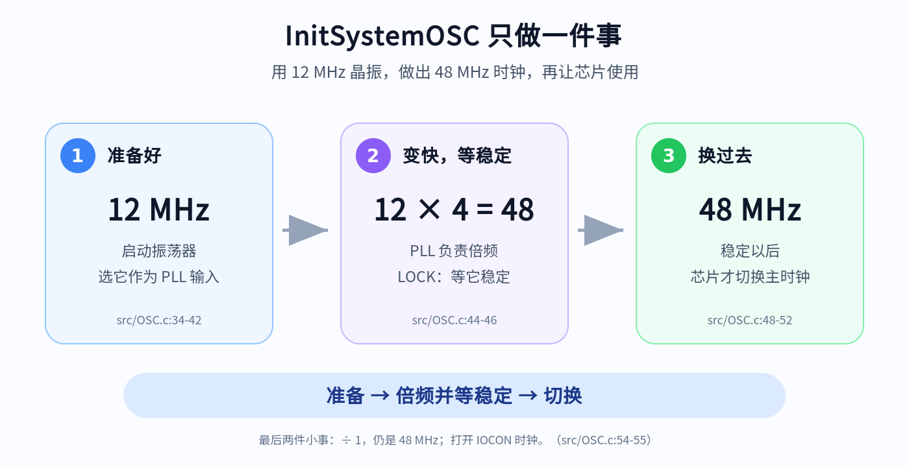

# InitSystemOSC：最简三步理解版

> 这一版先不背寄存器，只弄明白“这个代码到底在干什么”。

## 一句话

**这个函数就是：准备一个 12 MHz 时钟，用 PLL 把它变成 48 MHz，等稳定后，让芯片改用这个 48 MHz 时钟。**



[图片看不清时，打开可缩放的 SVG](assets/InitSystemOSC_最简三步图.svg)

## 现在只记三个动作

### ① 准备好

让 12 MHz 振荡器工作，并把它选为 PLL 的输入。

对应：`src/OSC.c:34-42`。

### ② 变快，等稳定

PLL 在这里做的事情很简单：

```text
12 MHz × 4 = 48 MHz
```

但刚得到的 48 MHz 还不能马上用，要等 PLL 给出“已经稳定”的信号。

对应：`src/OSC.c:44-46`。

### ③ 换过去

确认稳定后，才把芯片的主时钟切换到这个 48 MHz 输出。

对应：`src/OSC.c:48-52`。

**为什么要等？** 就像等机器启动稳定后再让它正式工作：没稳定就切换，系统时钟可能不可靠。

## 剩下两行只是收尾

- `src/OSC.c:54`：除以 1，所以仍然是 48 MHz，没有变慢。
- `src/OSC.c:55`：打开 IOCON 时钟，为后面的引脚配置做准备。

## 回头看代码时，先这样理解寄存器

| 看到这些东西 | 现在只把它们想成 |
|---|---|
| `PDRUNCFG` | 电源开关（这段代码里写 0 = 打开） |
| `SYSPLLCTRL` | 设置“12 × 4”的地方 |
| `SYSPLLSTAT` | 稳定指示灯 |
| `SYSPLLCLKUEN`、`MAINCLKUEN` | 确认键：让刚才的选择生效 |
| `MAINCLKSEL` | 选择芯片最终使用哪路时钟 |

这些名字以后会慢慢熟悉，**现在不需要背。**

## 你已经理解了，如果能说出这句话

> **先准备 12 MHz，再用 PLL 乘 4 得到 48 MHz；等它稳定，最后让芯片切换过去。**

这就是 `InitSystemOSC` 的主线。其他细节都是在完成或保护这三个动作，可以以后需要时再补。
